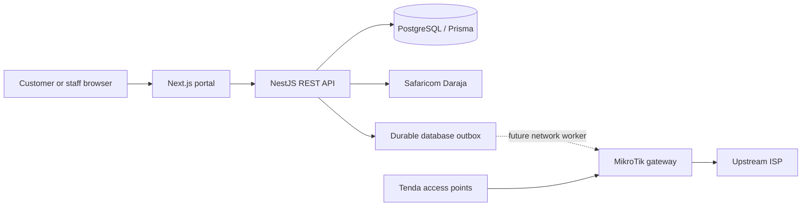

# Architecture

HiveNet is structured as a modular monolith: the Next.js app serves the customer purchase flow and staff sign-in; NestJS exposes REST endpoints; PostgreSQL is authoritative for tenants, packages, customers, orders, entitlements and audit-ready operations; Redis is provisioned for future job coordination but is not yet used by the app.

## Payment path

The API normalizes the phone and validates package ownership under the requested tenant. It snapshots package terms and creates an order with a tenant-scoped idempotency key before asking Daraja for STK Push. The public callback is stored in `PaymentCallback` and a deduplicated reconciliation event is inserted in the same transaction. A background poller queries Daraja; only a successful status query combined with matching callback amount, phone and receipt creates one entitlement and a network-activation outbox event. Browser redirects are never payment proof.

Daraja callbacks do not provide a general cryptographic signature in this integration. The callback is treated as an untrusted notification; the provider query and order checks gate confirmation. Secure HTTPS callback delivery and periodic financial reconciliation are still required.

## Tenant boundaries

Tenants are first-class database records and core business tables carry `tenantId`. Public package/payment operations resolve tenant slug on the server. Login tokens carry the user's tenant claim. **PostgreSQL row-level security and complete tenant-aware administration are not yet enabled.** Do not deploy this version as a multi-tenant production service until those controls and negative cross-tenant tests are completed.

## Failure handling

Database orders are persisted before the external STK request. Callback persistence is durable and idempotent. Reconciliation retries are bounded. Successful payment produces a `PENDING_NETWORK` entitlement; because no router adapter/worker is configured yet, the app does not claim that the user is online.
