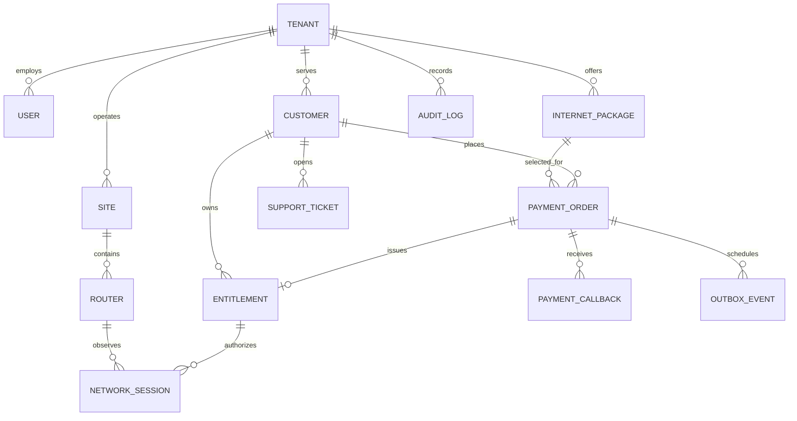

# Database

PostgreSQL is the system of record. Prisma schema lives at `apps/api/prisma/schema.prisma`. The seed script creates a `hivenet` tenant, a `Main site`, seven initial KES packages and, only when requested through environment variables, one tenant administrator.

## Core relationships

Tenant owns staff, sites, customers, packages, orders, entitlements and audit records. Sites hold router inventory and can scope packages and customers. An order snapshots package terms and belongs to a customer; one entitlement per order prevents duplicate issuance. Router sessions reference an entitlement. Callback events and outbox jobs are persisted for recovery.

Money uses integer minor units (`priceMinor` / `amountMinor`; 100 units per KES) rather than floating point. `BigInt` is used for byte counters.

## Migrations and recovery

The initial schema is captured in `apps/api/prisma/migrations/20261028000000_init`. Run `npm run db:migrate` locally to apply committed migrations. For schema changes, use `npm run db:migrate -w @hivenet/api -- --name <change>` and commit the generated migration. Production uses `npm run db:deploy`. Back up with PostgreSQL's `pg_dump`; validate restoration into a separate database before relying on backups. Retention and deletion policies must be finalized against Kenyan privacy and accounting obligations before production.

Tenant columns and indexes exist, but PostgreSQL RLS policies are not yet provided. Current API authorization is not sufficient to safely operate untrusted tenants.
