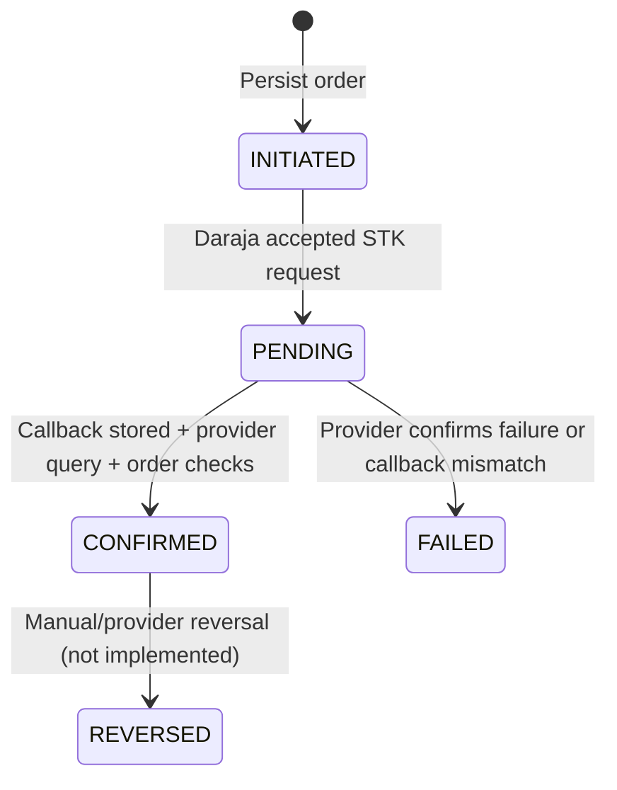

# Data flow and state machines

`CONFIRMED` payment creates exactly one entitlement keyed by unique `orderId`. Entitlement is initially `PENDING_NETWORK`; the user is not considered online. Network session statuses are `PENDING`, `AUTHORIZED`, `DISCONNECTED`, `FAILED`, but no adapter transitions them in this version. Expiry is calculated from confirmation time plus the snapshotted package duration; renewals and extension policy are not implemented.

Callback payload and `payment.reconcile` outbox row are written transactionally before returning a prompt acknowledgment. The poller queries Daraja and retries provider errors with a bounded attempt count. Provider query must succeed before order confirmation.
