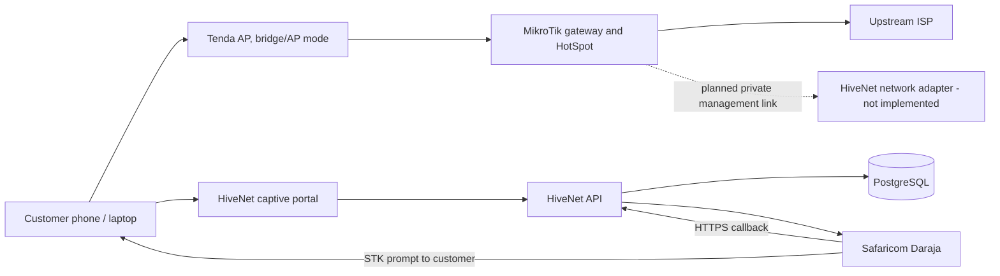

# Network diagram

This depicts the intended deployment, not an installed physical configuration. No RouterOS control plane is wired into the present code. See [MikroTik setup](MIKROTIK_SETUP.md) before planning hardware integration.
